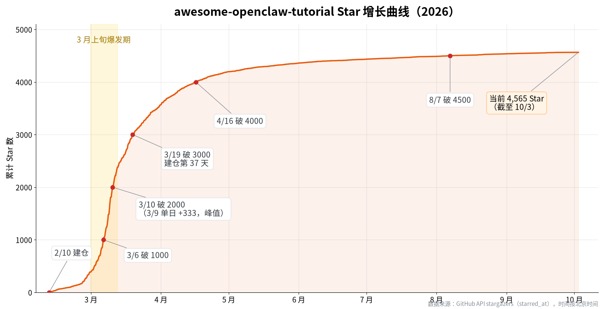
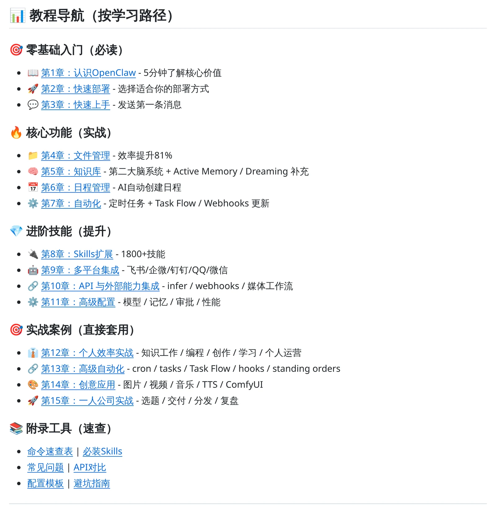
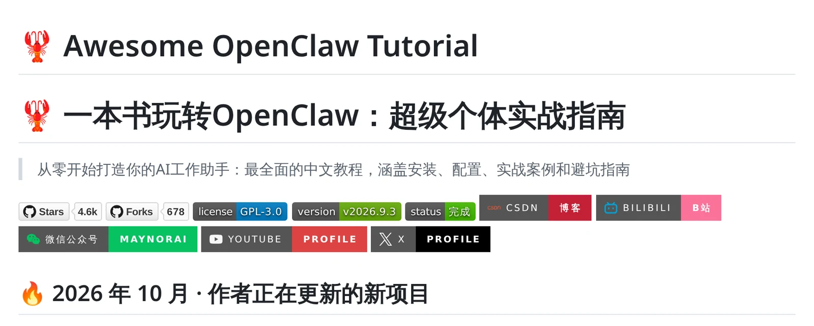
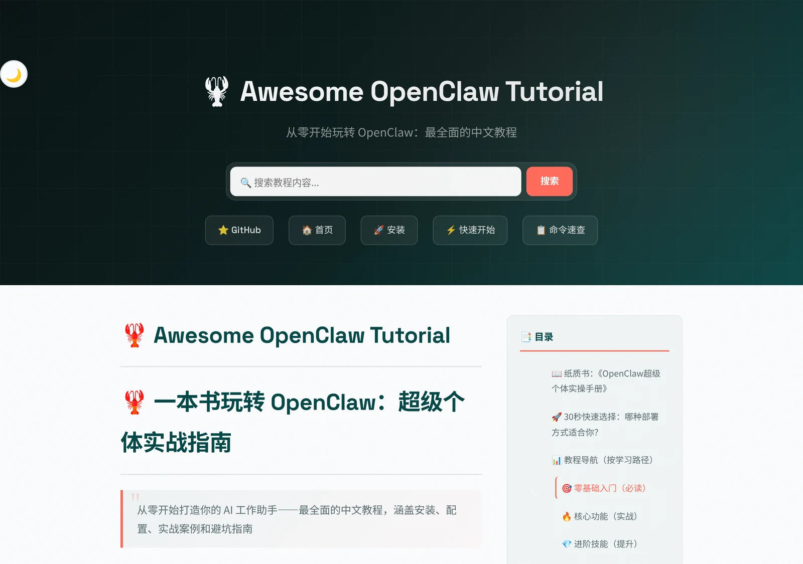
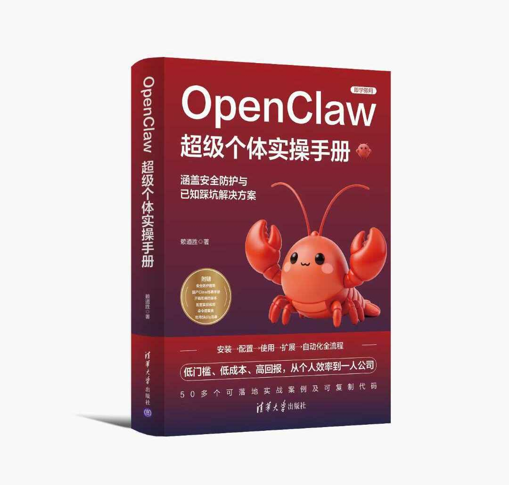
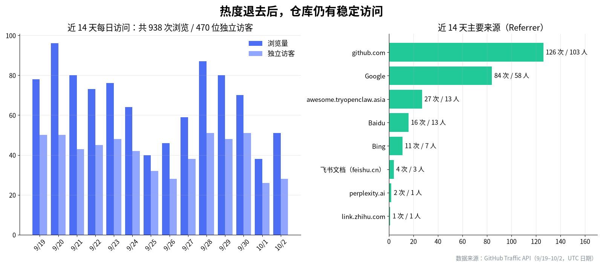
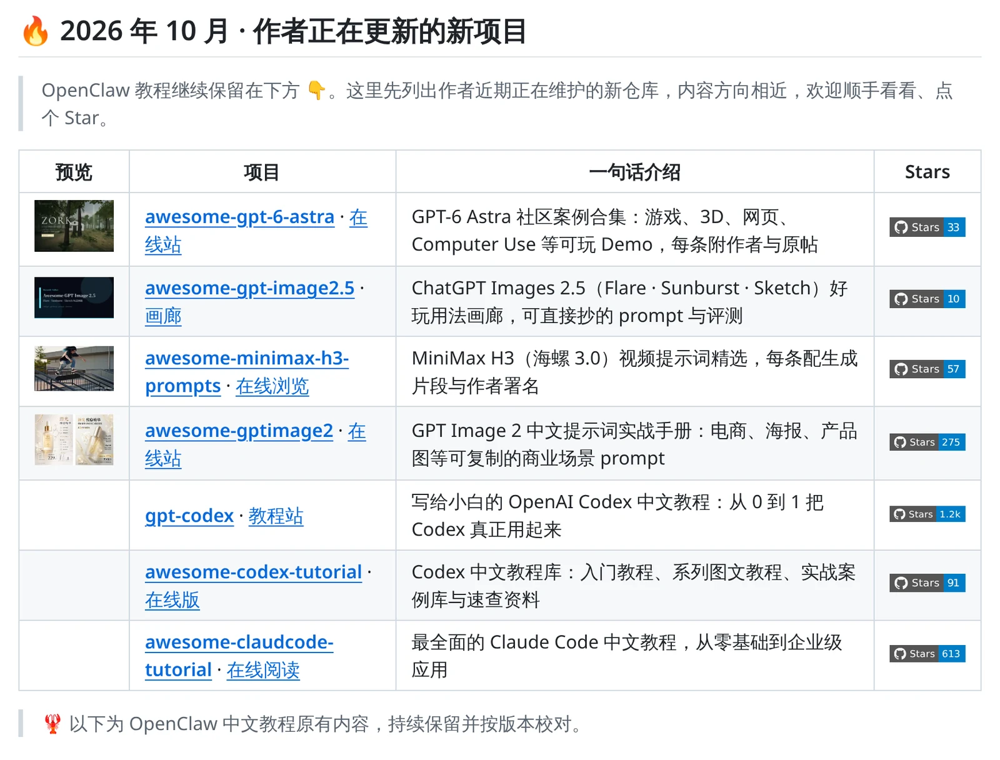
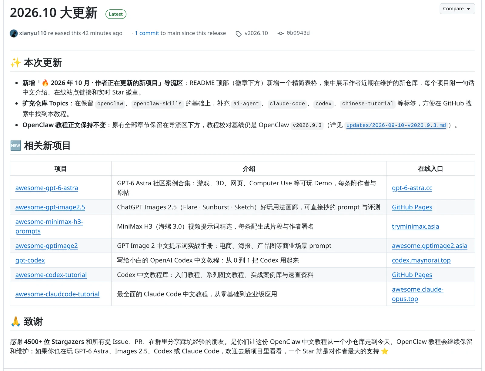

> 在线阅读（GitHub Pages）：https://maynor996.github.io/github-tutorial-4500-star/

# 一个人、零预算、抓住风口：我的 GitHub 教程拿到 4500 Star，还出了一本书

> 一个人写，没花一分钱推广，靠的就是抓住了 OpenClaw 爆火的窗口期。这篇把 awesome-openclaw-tutorial 从 0 到 4500+ Star、再到出书的过程拆开讲，每一步都可以照着做。

先交代一下成本：仓库托管用 GitHub，在线站用免费的 GitHub Pages，搜索靠站内搜索加 sitemap 被 Google 和百度收录，整个过程没投过广告，也没有团队。

### 一、它是怎么起来的：踩中了一个月的流量窗口

今年 2 月，OpenClaw 突然火了。那段时间到处都在讨论它，但中文资料很少，大多数人卡在安装和配置上。

我没想太多，就是跟着做了一个中文教程。2 月 10 日建仓，之后的加星速度是这样的：

  * 3 月 1 日：400 星
  * 3 月 6 日：900 星
  * 3 月 10 日：1900 星
  * 3 月 18 日：2900 星
  * 4 月 11 日：3900 星
  * 8 月初：4500 星

_图：仓库累计 Star 曲线（GitHub API 逐条 starred_at 数据，北京时间）。3 月 9 日单日涨了 333 颗星，是全年峰值。_

3 月上旬那十来天几乎每天涨一两百颗星，基本全来自 OpenClaw 本身的热度。复盘下来，第一条经验很朴素：**选题的时机比内容质量更早决定上限。** 一个工具突然爆火、中文资料又跟不上的时候，就是做中文教程的窗口期，而且窗口通常只有几周。

### 二、为什么流量来了能接得住

光有热度还不够，同期做 OpenClaw 中文资料的人不少。我觉得这几件事让它接住了流量：

  1. **一个仓库讲完整条路径。** 从安装、配置、Skills、飞书接入、服务器部署到避坑，按章节排好，还配了一份学习路线（LEARNING-PATH）。新手不用到处找。

_图：README 里的「教程导航（按学习路径）」，15 章从入门到实战一路排下来。_

  2. **README 首屏就把价值讲清楚。** 一句话说明是什么，下面是 Star、版本、状态徽章和目录，读者三秒内就知道这里有没有自己要的东西。

_图：README 首屏，标题 + 一句话定位 + 徽章，一眼看清是什么、到哪个版本了。_

  3. **跟版本走。** OpenClaw 更新很快，我每次大版本都重新校对，并在 README 顶部写清「当前按哪个版本校对、哪些章节已同步」。教程不过时，才会有人收藏和转发。

  4. **做了一个在线站。** GitHub 仓库加 GitHub Pages 站点，再做好站内搜索和 sitemap，后来 Google 和百度也带来了稳定的搜索流量。

_图：在线站首页（awesome.tryopenclaw.asia），顶部就是站内搜索。_

### 三、意外的收获：出成了书

开源教程攒下的结构和反馈，后来全面重写、逐条验证，出版成了纸质书《OpenClaw超级个体实操手册》（清华大学出版社）。开源内容不只换来了 Star，也是一份能拿得出手的作品集。

_图：《OpenClaw超级个体实操手册》，清华大学出版社 2026 年 4 月出版。_

这本书不是把仓库内容直接搬过去：144 条 CLI 命令对照官方文档逐条核对过，9 套配置模板都实际跑通，还新增了安全防护指南和国产 Claw 全景指南，随书附赠 7 份电子资料，全书 17 章。

🛒 想要系统学一遍的朋友可以从这里买：[京东专属链接（¥42，原价 ¥59.8）](<https://item.jd.com/14669463.html>)

### 四、热度退了，4500 颗星怎么办

OpenClaw 的热度已经过去，新星一两天才涨一颗。但我看了下仓库的访问数据，过去 14 天还有 938 次浏览、470 个独立访客，主要来自 GitHub 站内搜索和 Google，另外还有 678 个 fork。

_图：GitHub Traffic 数据，9/19–10/2 共 938 次浏览、470 位独立访客；来源前两名是 github.com 站内和 Google。_

**项目过气了，流量却没有归零。** 我做了三件小事，把这批流量导到我现在在做的项目上：

  1. 在 README 顶部加了一个「作者正在更新的新项目」表格，每天几十个访客看到的第一屏就是新项目；

_图：README 顶部新加的导流表格，每个新项目配预览图、在线站链接和实时 Star 徽章。_

  2. 发了一个「2026.10 大更新」Release，订阅仓库的人会收到通知；

_图：v2026.10 Release 页面，把更新说明和新项目列表一起推给订阅者。_

  3. 把 topics 从 2 个扩到 20 个，多吃一些站内搜索流量。

接下来会每周补一章其他 AI Agent 工具的上手教程，让它从「OpenClaw 教程」慢慢变成「AI Agent 中文实战教程」。

### 五、照着做的清单

  * 盯住「突然爆火 + 中文资料空白」的工具，动作要快，先占位再迭代；
  * README 是落地页，首屏只讲读者能得到什么；
  * 跟着版本更新，并在显眼处写明校对版本；
  * 搭一个在线站，把一次性的热度变成长期的搜索流量；
  * 热度退了别删仓库，高星老仓库就是你新项目最好的入口。

* * *

我现在在维护的新项目都放在 awesome-openclaw-tutorial 的 README 顶部，GitHub 搜仓库名就能找到。你在做开源项目时踩过哪些坑？欢迎评论区聊聊。